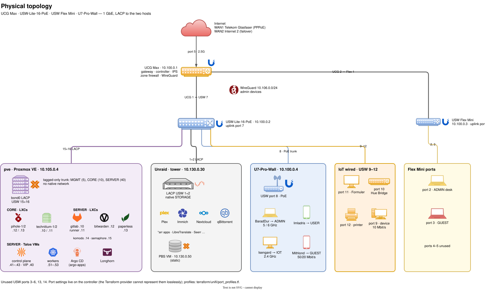
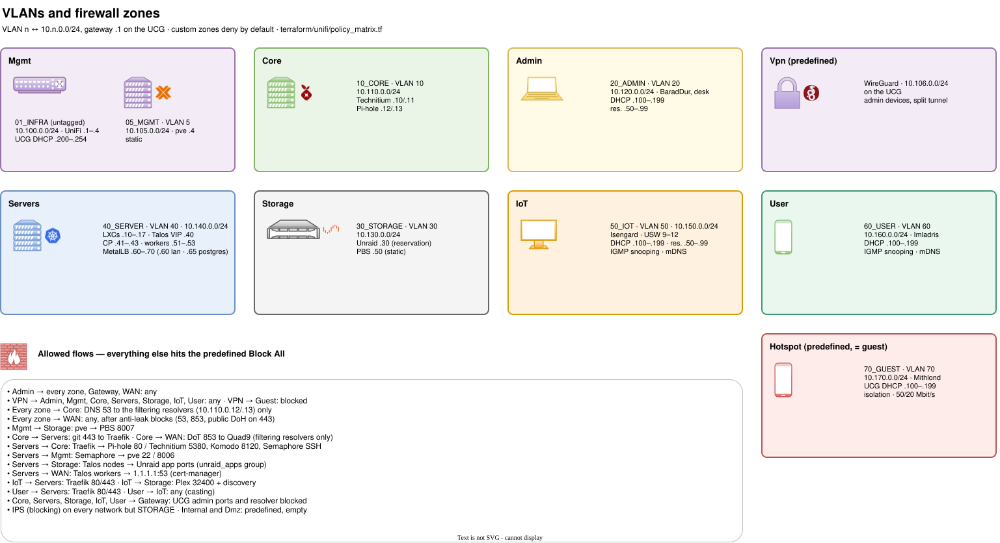
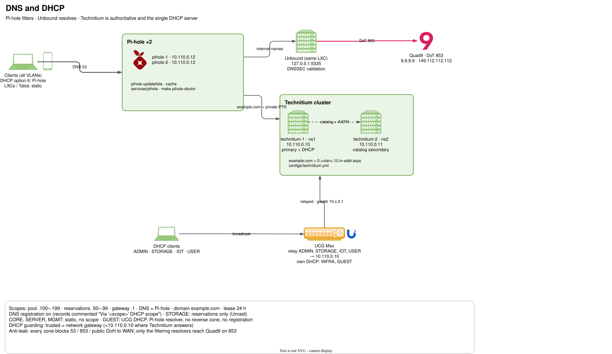
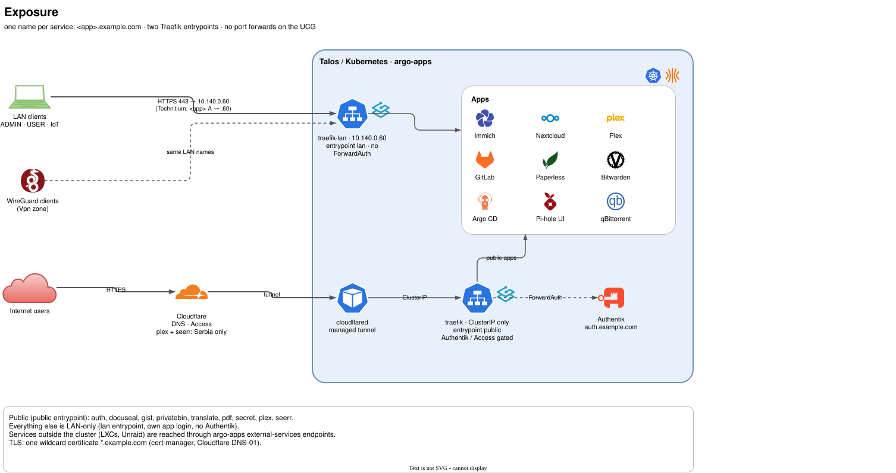

# Network

The homelab network on one UCG Max, two UniFi switches and one access point:
nine VLANs, a zone-based firewall, filtering resolvers (Pi-hole with an
Unbound sidecar) and Technitium for authoritative DNS and DHCP. IPv4 only.

<!-- markdownlint-disable MD013 MD060 -->

| What | Source of truth |
| --- | --- |
| Networks, Wi-Fi, zones, policies, IPS, port profiles, reservations | [`terraform/unifi/`](../terraform/unifi/README.md) (`make -C terraform/unifi plan`) |
| Technitium settings (forwarders, rate-limit bypass), zones, records, DHCP scopes | [`ansible/configs/technitium.yml`](../ansible/configs/technitium.yml) (`make -C ansible technitium-doctor`) |
| Pi-hole settings and lists | `FTLCONF_*` in [`services/pihole/docker-compose.yml`](../services/pihole/docker-compose.yml), lists in [`services/pihole/`](../services/pihole/) (`make -C ansible pihole-doctor`) |
| Diagrams | [`docs/diagrams/network.drawio`](diagrams/network.drawio) (`make diagrams`) |
| Settings the controller keeps outside the API | [UI-only settings](#ui-only-settings) |

<!-- markdownlint-enable MD013 MD060 -->

## Diagrams

Edit `docs/diagrams/network.drawio` in the draw.io desktop app, then run
`make diagrams` to regenerate the SVGs below and commit both. Device icons
come from draw.io's built-in Networks and Kubernetes libraries; product logos
are [Simple Icons](https://simpleicons.org) (CC0) embedded as images, so the
file needs nothing external. Add a logo by pasting its SVG into the diagram.

## Address plan

VLAN *n* is `10.n.0.0/24` with the gateway on `.1`; `.2`–`.9` are reserved for
network gear.

<!-- markdownlint-disable MD013 MD060 -->

| VLAN | Network | Zone | DHCP | Members |
| --- | --- | --- | --- | --- |
| untagged | `01_INFRA` 10.100.0.0/24 | Mgmt | UCG, `.200`–`.254` | UCG `.1`, USW-Lite-16 `.2`, Flex Mini `.3`, U7-Pro-Wall `.4` (reservations) |
| 5 | `05_MGMT` 10.105.0.0/24 | Mgmt | none | pve `.4` |
| 10 | `10_CORE` 10.110.0.0/24 | Core | none | technitium-1/2 `.10`/`.11`, filtering resolvers `.12`/`.13` ([Pi-hole](#filtering-resolvers)) |
| 20 | `20_ADMIN` 10.120.0.0/24 | Admin | Technitium, `.100`–`.199` | admin devices; reservations `.50`–`.99` |
| 30 | `30_STORAGE` 10.130.0.0/24 | Storage | Technitium, reservations only | Unraid `.30` (reservation), PBS VM `.50` (static) |
| 40 | `40_SERVER` 10.140.0.0/24 | Servers | none | LXCs `.10`–`.17`, Talos VIP `.40`, control plane `.41`–`.43`, workers `.51`–`.53`, MetalLB `.60`–`.70` |
| 50 | `50_IOT` 10.150.0.0/24 | IoT | Technitium, `.100`–`.199` | reservations `.50`–`.99` |
| 60 | `60_USER` 10.160.0.0/24 | User | Technitium, `.100`–`.199` | family devices |
| 70 | `70_GUEST` 10.170.0.0/24 | Hotspot | UCG, `.100`–`.199` | guests |
| — | WireGuard 10.106.0.0/24 | Vpn | — | admin devices, split tunnel |

<!-- markdownlint-enable MD013 MD060 -->

MetalLB pins `10.140.0.60` (`traefik-lan`, the address every app name resolves
to) and `10.140.0.65` (PostgreSQL). Traefik's public entrypoint has no LAN
address: the Cloudflare tunnel reaches it by ClusterIP. The LXC addresses
live in [`terraform/lxc/instances/`](../terraform/lxc/instances/), the Talos
ones in
[`terraform/talos/`](../terraform/talos/README.md).

## Firewall zones

Mgmt, Core, Admin, Servers, Storage, IoT and User are custom zones: every
inter-zone flow is blocked unless
[`policy_matrix.tf`](../terraform/unifi/policy_matrix.tf) allows it. GUEST
uses the predefined Hotspot zone, whose built-in policies give guests only DNS,
DHCP and ICMP towards the gateway. Internal and Dmz are predefined, empty and
unused.

<!-- markdownlint-disable MD013 MD060 -->

| From | Allowed |
| --- | --- |
| Admin | everything |
| Vpn | every zone except Guest |
| every zone | DNS to the filtering resolvers; the internet behind the anti-leak blocks (53, 853, public DoH on 443) |
| Mgmt | pve → PBS 8007 |
| Core | git 443 to Traefik (Komodo Periphery clones); filtering resolvers → Quad9 DoT 853 |
| Servers | Traefik → resolver and Technitium UIs, Komodo → Periphery 8120, Semaphore → SSH and the pve API, Talos nodes → Unraid app ports, Talos nodes → Core host exporters (9100, 9338, 12345) and the pve API 8006 (Prometheus), Talos workers → 1.1.1.1:53 (cert-manager) |
| Storage | Unraid → Traefik 443 (rclone Nextcloud backup) |
| IoT | Traefik 80/443, Plex on Unraid |
| User | Traefik 80/443, everything in IoT (casting) |

<!-- markdownlint-enable MD013 MD060 -->

Every non-admin zone is blocked from the UCG admin ports and its resolver. IPS
runs in blocking mode on every network except STORAGE (qBittorrent is wanted
P2P traffic).

## DNS and DHCP

- Clients resolve through the filtering resolvers (`10.110.0.12`,
  `10.110.0.13`). Each sends internet names to Unbound on the same host (DoT
  to Quad9, DNSSEC validation) and `example.com` plus every private reverse
  lookup to Technitium.
- technitium-1 is the primary for `example.com` and one reverse zone per /24
  (`0.<vlan>.10.in-addr.arpa`, none for GUEST). Every zone is a member of the
  cluster catalog, so technitium-2 picks up new zones without manual steps.
- technitium-1 is the only DHCP server; the UCG relays ADMIN, STORAGE, IOT and
  USER to it. Leases register their hostname in DNS (records commented
  `Via '<scope>' DHCP scope`). A reserved host must not also get a static
  record — the reservation re-registers its name.
- DHCP guarding is on everywhere: only the network's gateway, plus
  `10.110.0.10` where Technitium answers, may send DHCP replies.

### Filtering resolvers

Two Pi-hole LXCs answer on the resolver IPs. Everything else (zone policies,
IPS exclusions, DHCP DNS options, Talos nameservers, the patch DNS gate) is
keyed by the IP.

| IP | Resolver |
| --- | --- |
| `10.110.0.12` | pihole-1 |
| `10.110.0.13` | pihole-2 |

- Every setting is an `FTLCONF_*` variable in the compose file and
  read-only in the web UI. pihole-updatelists applies the lists in
  [its config](../services/pihole/pihole-updatelists.conf) daily and removes
  anything else, UI additions included. The UI at `pihole<N>.example.com`
  logs in with `web_password` from Vault; the app password for
  `pihole-doctor` and the MCP tools is set per node in the UI (Settings,
  Web interface / API) and kept in Vault as `kv/proxmox-infra/pihole`
  `app_passwords`.
- Query history, statistics and logs: FTL prunes anything older than
  `FTLCONF_database_maxDBdays` (30). For a fresh start,
  `make -C ansible pihole-reset CONFIRM=yes` (`NODES=pihole-2` for one,
  `ARGS=--check` to rehearse) deletes `pihole-FTL.db` and recreates the
  container through Komodo, one node at a time and only while the partner
  answers DNS; gravity, settings and app passwords stay. Also the Semaphore
  template "Pi-hole: Reset" (its Dry Run box rehearses).

## Switch ports

Port settings stay on the controller: the provider's `unifi_device` cannot
represent them without loss. Change them in the UI. The profiles they use
are Terraform (`terraform/unifi/port_profiles.tf`); assigning a profile to
a port is a UI step. A profile cannot turn a port off: unused ports are set
to Port State: Disabled on the port itself.

<!-- markdownlint-disable MD013 MD060 -->

| Switch | Port | Use |
| --- | --- | --- |
| USW-Lite-16-PoE | 1+2 | Unraid, LACP, profile `access-storage` |
| | 7 | uplink to UCG port 1 |
| | 8 | U7-Pro-Wall (PoE), trunk |
| | 9–12 | IoT access ports, profile `access-iot`, Port Mode Edge set on the profile in the UI (9: Sky Stream, 10: Hue Bridge, 11: Formuler, 12: printer) |
| | 15+16 | pve, LACP, profile `trunk-proxmox` |
| | 3–6, 13, 14 | unused, Port State: Disabled |
| USW Flex Mini | 1 | uplink to UCG port 2 |
| | 2 | ADMIN access (desk) |
| | 3 | GUEST access |
| | 4, 5 | unused, Port State: Disabled |

<!-- markdownlint-enable MD013 MD060 -->

## Wi-Fi

<!-- markdownlint-disable MD013 MD060 -->

| SSID | Network | Security | Bands | Notes |
| --- | --- | --- | --- | --- |
| BaradDur | ADMIN | WPA3, PMF required | 5, 6 GHz | hidden |
| Imladris | USER | WPA2/WPA3, PMF optional | 2.4, 5 GHz | |
| Isengard | IOT | WPA2, PMF off | 2.4 GHz | client isolation |
| Mithlond | GUEST | WPA2/WPA3, PMF optional | 2.4, 5 GHz | client isolation, 50/20 Mbit/s per client |

<!-- markdownlint-enable MD013 MD060 -->

The mDNS reflector covers ADMIN, IOT and USER (printers, AirPlay, casting);
IGMP snooping is on for IOT and USER.

## Remote access and exposure

WireGuard on the UCG (`10.106.0.0/24`, Vpn zone) gives admin devices the same
LAN names; there are no port forwards. Public services reach the cluster only
through the Cloudflare tunnel to Traefik `public` — see
[ARCHITECTURE.md](ARCHITECTURE.md) for the entrypoint model.

## UI-only settings

The controller keeps these outside what the Terraform provider can write.
Change them in the UniFi UI and record the change here:

- **DHCP relay target** (`10.110.0.10`) on each relayed network.
- **mDNS scope** (Settings → Networks → Global Network Settings): ADMIN, IOT,
  USER.
- **IPS detection exclusions** (CyberSecure → Intrusion Prevention):
  `10.120.0.0/24`, `10.106.0.0/24`, `10.110.0.12`, `10.110.0.13`. Without them,
  git over SSH from ADMIN or WireGuard trips the scan signatures.
- **Switch port settings** (see [Switch ports](#switch-ports)).
- **Spanning tree**: RSTP with Auto STP Edge on (SafeOps), so ports to end
  devices skip convergence; USW-Lite-16-PoE has STP priority 4096 and stays
  root. pve and Unraid each have a single uplink, so edge detection on their
  bridges cannot hide a loop. No BPDU guard on ports 1/2, 8, 15/16.
- **SafeOps safeguards**: Test & Confirm and Management VLAN Rollback revert
  a change that leaves a device unreachable. The Flex Mini does not support
  them; its changes apply immediately.

## Changing the network

1. Edit the Terraform, Technitium or Pi-hole config.
2. Plan or dry-run (`make -C terraform/unifi plan`,
   `make -C ansible technitium-bootstrap ARGS=--dry-run`), apply, then confirm
   the doctor or plan reports no changes.
3. Update the diagram if the topology changed, run `make diagrams`, and commit
   config, diagram and SVGs together.

Zone or policy changes take a few seconds to reach the UCG; test after that.
